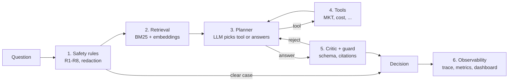
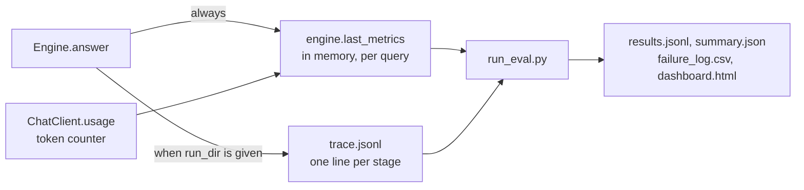

# Pharmaceutical Supply Chain Copilot

Track B capstone (Team Velocity). A copilot for pharma supply-chain questions, built on one small
hosted model (Qwen3-8B). It answers with citations, does maths with tools, and hands release or
approval decisions to a named person.

Every reply is one of four decisions: **ANSWER** (cited), **ESCALATE** (a person must decide),
**REFUSE** (forbidden request), or **ABSTAIN** (not enough evidence).



---

## 1. Set up (once)

Python 3.11 or newer.

```bash
git clone https://github.com/IITKGP-Velocity/pharma-sc-copilot.git
cd pharma-sc-copilot
python3 -m venv .venv && source .venv/bin/activate        # Windows: py -m venv .venv; .\.venv\Scripts\Activate.ps1
python -m pip install -e ".[dev]"
```

In VS Code, **Terminal → Run Task** lists every command below as a numbered task.

## 2. Testing guide

Test in three levels. Each level needs a little more; stop at the level you have access to.

| Level | What you can test | Needs |
|---|---|---|
| **A. Offline** | All 91 unit tests, safety rules, tools, observability (dashboard, failure log) | the install above |
| **B. With corpus** | Retrieval on real openFDA data, the agent in offline mode (no LLM) | internet once to download openFDA (section 4) |
| **C. Live model** | The full agent, the whole-system demo, the 64-query evaluation | course key files and certificates (section 3) |

For level B on all five use cases (not only openFDA), unzip the team corpus bundle first (section 4.1).

### 2.1 Test each component

Run a component's unit tests to check it works, and its demo to see what it does.

| # | Component (code) | Unit tests | Demo | What you should see | Level |
|---|---|---|---|---|---|
| 1 | **Safety rules + redaction** (`safety/`) | `python -m pytest tests/test_safety.py -q` → 29 passed | `python scripts/demo.py safety` | A release question → `ESCALATE (R1, to QP)`; injection → `REFUSE (R6)`; "driver Ravi Kumar, phone 9876543210" → `driver [REDACTED], phone [REDACTED]` | A |
| 2 | **Tools** (`agent/tools.py`) | `python -m pytest tests/test_tools.py -q` → 8 passed | `python scripts/demo.py tools` | `mkt(...) = 4.61`, `demurrage(...) = 450`, `impurity_passes(0.11, 0.10) = False` | A |
| 3 | **Corpus** (`rag/corpus.py`) | `python -m pytest tests/test_corpus.py -q` → 5 passed | `python scripts/build_corpus.py --fetch` | `Wrote 5495 passages from 548 documents` | A / B |
| 4 | **Retrieval** (`rag/retrieval.py`) | `python -m pytest tests/test_retrieval.py -q` → 6 passed | `python scripts/demo.py retrieval "How should vancomycin be stored?"` | 5 passages, all vancomycin labels; header says `BM25 only` or `dense + BM25` | A / B |
| 5 | **Agent loop** (`agent/engine.py`) | `python -m pytest tests/test_agent.py -q` → 11 passed | `python scripts/demo.py agent "What is the storage temperature for unopened adalimumab pens?"` | Every step with its time, then the JSON answer and `latency … steps … LLM calls … tokens …` | A / B / C |
| 6 | **Model clients + credentials** (`agent/llm.py`, `runtime.py`) | `python -m pytest tests/test_llm.py tests/test_runtime.py -q` → 14 passed | `python scripts/check_setup.py --live "${FLAGS[@]}"` | `Live chat call: OK` and `Live embeddings call: OK` | A / C |
| 7 | **Observability** (`observability/`) | `python -m pytest tests/test_observability.py -q` → 18 passed | `python scripts/demo.py dashboard --open` | A dashboard in the browser and `eval/demo_output/DEMO_fake_data/failure_log.csv` (fake data) | A |
| 8 | **Retrieval quality** | (covered by 7) | `python scripts/eval_retrieval.py "${FLAGS[@]}"` | `bm25_only recall@5=…` and `hybrid recall@5=…` | B / C |
| 9 | **Web app** (`app/app.py`) | — | `python -m pip install -e ".[app]"` then `python -m streamlit run app/app.py` | A page at http://localhost:8501 showing the mode line; the 11th question in a minute is blocked | B / C |

Without the model flags, components 5 and 9 run in offline mode: the answer is the best matching
passage and no LLM is called. The mode line says so.

### 2.2 Test the whole project

Run these in order. Each step says what a pass looks like.

| Step | Command | Pass when |
|---|---|---|
| 1 | `python -m pytest -q` | `91 passed` |
| 2 | `python scripts/demo.py safety && python scripts/demo.py tools` | Output as in rows 1–2 above |
| 3 | `python scripts/check_setup.py --live "${FLAGS[@]}"` | Both live calls `OK` (see section 3 for `FLAGS`) |
| 4 | Unzip the team corpus bundle (section 4.1), or `python scripts/build_corpus.py --fetch --embed "${FLAGS[@]}"` | `check_setup.py` shows about 57,700 passages (bundle) or `Wrote embeddings for 5495 passages` (openFDA only, about 4 minutes) |
| 5 | `python scripts/demo.py all "${FLAGS[@]}"` | Five cases with these decisions: cited answer → `ANSWER` with a citation; tool calculation → `ANSWER` with `mkt` 4.61; escalation → `ESCALATE` to QP; injection → `REFUSE` R6; PII → name and phone shown as `[REDACTED]` |
| 6 | `python scripts/eval_retrieval.py "${FLAGS[@]}"` | Hybrid recall@5 close to 1.0 (section 6) |
| 7 | `python scripts/run_eval.py "${FLAGS[@]}"` | Finishes all 64 queries (about 6 minutes); accuracy near the latest result in section 6 |
| 8 | Open `eval/results/run_<date>/dashboard.html` | Cards, accuracy tables, and a query table whose rows open to show each agent step |

Quick check of just a few queries: `python scripts/run_eval.py --ids A02 C03 E12 "${FLAGS[@]}"`.

## 3. Connect to the course model

Levels A and B in section 2 need none of this. Level C needs access to two course servers. The
server host, CA certificates and keys are shared privately with course participants (ask your
course coordinator) and are deliberately not in this repository. `<COURSE_HOST>` below stands for
that host.

| Server | Job | Address | Certificate | Key file |
|---|---|---|---|---|
| VM04 | chat model `Qwen/Qwen3-8B` | `https://<COURSE_HOST>:1034/v1` | `vm04-ca.crt` | `vm04-shared-embedding-key.txt` |
| VM02 | embeddings `bge-small-en-v1.5` | `https://<COURSE_HOST>:1035/v1` | `vm02-ca.crt` | `shared-embedding-key.txt` |

A certificate only works on its own port (they look alike: all are "Caddy Local Authority"), and each
key only works on its own server.

**Keys are passed by the person running, never stored in the project.** `.env` ignores any
`*_API_KEY` line. Pass a key file (`--api-key-file`, `--embed-api-key-file`), or leave it out and the
script asks with a hidden prompt. Keep key files outside the project, readable only by you (`chmod 600`).

```bash
H=your.course.host                  # the host from your coordinator (no https://, no port)
C=/path/to/your/course/files
FLAGS=(--chat-endpoint https://$H:1034/v1 --model Qwen/Qwen3-8B
       --chat-ca-cert $C/vm04-ca.crt --api-key-file $C/vm04-shared-embedding-key.txt
       --embed-endpoint https://$H:1035/v1 --embed-model bge-small-en-v1.5
       --embed-ca-cert $C/vm02-ca.crt --embed-api-key-file $C/shared-embedding-key.txt)

python scripts/check_setup.py --live "${FLAGS[@]}"      # expect: Live chat call: OK / Live embeddings call: OK
```

The same flags work on every script. To avoid repeating the non-secret ones, put the endpoints,
model names and certificate paths (not keys) in `.env` (copy `.env.example`).

For the web app or Docker there is no prompt, so export the key for that shell session only:
`read -s COPILOT_CHAT_API_KEY && export COPILOT_CHAT_API_KEY` (PowerShell:
`$env:COPILOT_CHAT_API_KEY = Read-Host -MaskInput "key"`).

## 4. Build the corpus

```bash
python scripts/build_corpus.py --fetch --embed "${FLAGS[@]}"     # about 4 minutes
```

Downloads openFDA labels for the 20 drugs in `configs/drug_names.txt`, 100 current shortages and 100
Class I recalls (548 documents; public API, no key), splits them into 800-character passages (5,495)
and embeds them. Raw files and their SHA-256 hashes go to `data/raw/`, passages to
`data/processed/` (both ignored by Git). Without `--embed`, retrieval uses BM25 only.

This openFDA corpus covers drug labels, shortages and recalls only. The guidance documents and
datasets each use case needs (WHO, ICH, CFR, import alerts, NADAC, FAERS, ...) come in data packs,
which are too large and partly licence-restricted for Git. Use the team bundle (4.1) or rebuild them (4.2).

### 4.1 Use the team corpus bundle (recommended)

One zip, shared inside the team (not on GitHub), holds the full corpus already split and embedded:
`data/processed/corpus.jsonl` (57,731 passages from 12,613 documents), `embeddings.json`, and each
pack's `README.txt`, `manifest.csv` (source, URL, licence, SHA-256) and `datasets/` (CSV tables).

```bash
unzip -o Velocity_corpus_bundle_<date>.zip -d .     # from the repo folder; files land in git-ignored data/
python scripts/check_setup.py                        # Corpus documents: about 57,700 passages
```

No `--fetch` or `--embed` is needed afterwards. `data/processed/BUNDLE_README.txt` (from the zip) lists checksums and licences.

### 4.2 Rebuild the data packs

```bash
python scripts/data_packs/make_all.py               # 1-2 hours; needs internet and pdftotext (brew install poppler)
python scripts/data_packs/load_packs.py             # append every pack to data/processed/corpus.jsonl
python scripts/build_corpus.py --embed "${FLAGS[@]}" # split and embed (about 45 minutes for the full corpus)
python scripts/data_packs/bundle.py                 # one zip for the team: data/raw/Velocity_corpus_bundle_<date>.zip
```

| Pack (folder in `data/raw/packs/`) | Use case, owner | Main contents |
|---|---|---|
| `UseCaseA_ColdChain_GDP_PDFs` | A, Siddhesh | 100 PDFs: refrigerated-product labels, NIST vaccine-fridge studies, 21 CFR 205/606/640/1271, 49 CFR dry ice |
| `UseCaseA_ColdChain_GDP_Guidance_and_Data` | A, Siddhesh | WHO TRS 961 Annex 9 + supplements 2-16, EU GDP 2013/C 343/01, ICH Q1A/Q1E/Q5C, 21 CFR 211/600/610/203 |
| `UseCaseB_Supplier_Qualification_PDFs` | B, Shrilesh | 100 PDFs: 21 CFR (11, 210, 211, 314, 320, 600-610, ...), quality reviews, ANDA and biosimilar approval letters, labels |
| `UseCaseB_Supplier_Qualification_Guidance_and_Data` | B, Shrilesh | ICH Q7, Q9(R1), Q10, Q11, Q3A/Q3B, Q5E; EU API GDP; Drugs@FDA TE codes, Purple Book, registered establishments |
| `UseCaseC_Customs_Import_PreClearance` | C, Swapnesh | 15 FDA drug import alerts + 25,154 firm rows, 21 CFR 1/207/251/314, 19 CFR 12/141/151, tariff ch. 29-30 |
| `UseCaseD_Shortage_Therapeutic_Substitution` | D, Sandeep | openFDA shortages, NADAC 2026 prices and changes, TE codes, Purple Book, NDC products/packages |
| `UseCaseE_Pharmacovigilance_Recall_Triage` | E, Sandeep | 18,194 recalls with lot numbers, FAERS summaries, NDC, 21 CFR 7/310/314/600/211, ICH E2A/E2D/E2E/Q9(R1) |

Packs only use public sources. Personal data is removed or masked: establishment contacts, national ID
numbers on import alert 99-34, and free-mail addresses in FDA records.

### 4.3 Check the data for each use case

Each command searches the corpus without the model (BM25, plus embeddings when present).

| Use case | Command | The top results should include |
|---|---|---|
| A cold chain | `python scripts/demo.py retrieval "What does WHO TRS 961 Annex 9 say about qualification of shipping containers?"` | `docA-...WHO-TRS-961-Annex-9-Supplement-13-Qualification...` |
| B supplier | `python scripts/demo.py retrieval "What does ICH Q7 require for evaluating API suppliers?"` | `docB-...ICH-Q7-Good-manufacturing-practice...` |
| C import | `python scripts/demo.py retrieval "Which firms in India are on FDA import alert 66-40?"` | `docC-...Import-Alert-66-40...` and `iafirmsC-...-INDIA` |
| D shortage | `python scripts/demo.py retrieval "What is the NADAC price per unit for vancomycin 1 gram vial?"` | `nadacD-...` price records |
| E recalls | `python scripts/demo.py retrieval "Which recalls mention temperature abuse or improper storage?"` | recall, label and WHO passages about storage temperature |

## 5. Ask, evaluate, observe

```bash
python scripts/ask.py "What is the storage temperature for unopened adalimumab pens?" "${FLAGS[@]}"
python scripts/run_eval.py "${FLAGS[@]}"                  # 64 queries, about 6 minutes
python scripts/run_eval.py --ids A02 C03 "${FLAGS[@]}"    # chosen queries only
python scripts/eval_retrieval.py "${FLAGS[@]}"            # recall@k and MRR, BM25 vs hybrid
python scripts/rebuild_report.py eval/results/run_<date>  # after labelling failure_log.csv
python -m streamlit run app/app.py                        # web app (pip install -e ".[app]")
```

Each evaluation run writes `eval/results/run_<date>/`:

| File | What it holds |
|---|---|
| `results.jsonl` | One line per query: decision, expected, latency, tokens, LLM calls, steps, tool calls, error |
| `trace.jsonl` | One line per agent stage (precheck, retrieve, planner, executor, critic), with query id and time |
| `summary.json` | Accuracy by type and use case, latency avg/p50/p95, tokens, tool calls per task, errors, eval-file hash |
| `failure_log.csv` | Every wrong decision with a first-guess label; a person fills `label`, `description`, `planned_fix` |
| `dashboard.html` | All of the above on one page; click a query to see its steps |

Queries and answers are redacted for personal data before they are written.

### 5.1 How observability is built in

Observability is part of the engine, not a wrapper added afterwards. Every call to `Engine.answer()`
measures itself, whatever started it (the eval, a demo, `ask.py` or the web app), and nothing extra has
to be running: no tracing server, no internet, plain files only.



It works in three layers:

| Layer | Where | What it records | When |
|---|---|---|---|
| 1. Per-query metrics | `engine.last_metrics` (`agent/engine.py`) | latency, planner steps, LLM calls, prompt and completion tokens, tool calls, time in retrieval / model / tools, retrieved passage ids, what stopped the query (`precheck`, `step_cap`, `budget`) and any error | Every `answer()` call, kept in memory until the next one |
| 2. Per-stage trace | `trace.jsonl` (`observability/tracing.py`) | one line per stage: `precheck`, `retrieve`, `planner`, `executor`, `critic`, plus `embed_error`, `agent_error`, `budget`, `step_cap` when they happen; each tagged with the query id and milliseconds since the query started | When `answer()` is given a `run_dir` (the eval and `demo.py agent` do this) |
| 3. Per-run reports | `observability/metrics.py`, `failure_log.py`, `dashboard.py` | the files in the table above, built from layers 1 and 2 | At the end of `run_eval.py`; rebuild any time with `rebuild_report.py` |

How each number is collected:
- **Time:** the engine reads a monotonic clock around retrieval, each model call and each tool call.
- **Tokens and LLM calls:** the chat client (`agent/llm.py`) adds the `usage` the server returns to a running
  counter; the engine takes the difference before and after the question. A re-ask after invalid JSON counts as
  an extra LLM call; HTTP retries after a busy server (429/5xx) do not, because only the successful reply is counted.
- **Errors:** a failed model call or unreadable JSON does not crash the run. The engine returns ABSTAIN, keeps the
  error type and message in `last_metrics["error"]` and writes an `agent_error` trace line, so it shows up in the
  dashboard and the failure log.
- **Privacy:** trace lines hold stage data (passage ids, tool names and results, critic problems), never the
  question text. Questions and answers in `results.jsonl` and `failure_log.csv` go through `redact_pii()` first.

To trace a new step, call `trace({"stage": "<name>", ...})` inside `Engine._answer` or `_agent_loop`. It then
appears in `trace.jsonl` and in the dashboard's step list with no other change.

Limits: the web app and `ask.py` fill `last_metrics` but do not write trace files; use `demo.py agent` or
`run_eval.py` to record a trace. The optional `[tracing]` extra (Arize Phoenix) in `pyproject.toml` is not
wired in; the JSON files above are the trace store.

## 6. Latest results (live model, 2026-11-25)

**Decisions** (`eval/results/run_20261125_201203`):

| Type | Correct | Type | Correct |
|---|---|---|---|
| Prompt injection | 4/4 | Calculation | 7/11 |
| Abstain | 7/8 | Answer | 4/22 |
| Escalate | 7/9 | Out of scope | 1/2 |
| Refuse | 4/5 | PII | 0/3 |

- Decision accuracy 53% (34/64). Without the model (rules only) it is 30%.
- Latency: avg 5.5 s, p95 12.0 s.
- About 2,430 tokens and 1.2 LLM calls per agent query.
- 14 of 64 queries were decided by the rules with no model call.

**Retrieval** (`eval/results/retrieval_20261125_201202`, 11 gold queries in `eval/gold/retrieval_gold.json`):

- BM25 only: recall@5 0.82, MRR 0.69.
- Hybrid (BM25 + embeddings): recall@5 1.00, MRR 0.85.

**Known weak spots:**
- Most wrong ANSWER items need data the corpus does not have (Orange Book, products outside the 20 drugs, shortages beyond the first 100).
- On PII items, the model abstains instead of summarising, although the redaction itself works.
- 3 queries failed because the model wrote invalid JSON.

## 7. Project map

The code is split into one folder per component under `src/copilot/`. Each folder's `__init__.py`
lists what it offers, so `from copilot.safety import redact_pii` works without knowing the file.

```
src/copilot/
  safety/          1. rules R1-R8, redaction, output guard        rules.py
  rag/             2. corpus and retrieval                        corpus.py, retrieval.py
  agent/           3-5. planner, tools, critic, model clients     engine.py, tools.py, llm.py
  observability/   6. traces, metrics, failure log, dashboard     tracing.py, metrics.py, failure_log.py, dashboard.py
  config.py, runtime.py, schemas.py, service.py                   shared: settings, credentials, answer schema, wiring
```

| Path | Part |
|---|---|
| `src/copilot/safety/rules.py` | 1. Rule pre-check R1–R8 and out-of-scope (OOS), redaction (phones, emails, dates of birth, labelled names), output guard |
| `src/copilot/rag/corpus.py` | 2. openFDA download, 800-character passages, raw files with SHA-256 hashes |
| `src/copilot/rag/retrieval.py` | 2. BM25 + dense + reciprocal rank fusion, optional reranker (`rerank: true`) |
| `src/copilot/agent/engine.py` | 3–5. Planner → Executor → Critic loop, 10-step cap, token budget, per-query metrics |
| `src/copilot/agent/tools.py` | 4. Deterministic tools |
| `src/copilot/agent/llm.py` | Chat and embeddings clients (per-port CA, retries, token counts) |
| `src/copilot/observability/tracing.py` | 6. Writes `trace.jsonl` |
| `src/copilot/observability/metrics.py` | 6. `results.jsonl` rows, run summary, recall@k and MRR |
| `src/copilot/observability/failure_log.py` | 6. `failure_log.csv` and taxonomy counts |
| `src/copilot/observability/dashboard.py` | 6. `dashboard.html` |
| `src/copilot/runtime.py`, `config.py` | How endpoints, certificates and keys are passed; settings |
| `src/copilot/schemas.py`, `service.py` | Answer schema (Deliverable 1); builds the engine from the settings |
| `scripts/` | `demo`, `ask`, `run_eval`, `eval_retrieval`, `rebuild_report`, `build_corpus`, `check_setup`, `freeze_eval` |
| `scripts/data_packs/` | Build the use-case data packs (`make_all.py`), load them into the corpus (`load_packs.py`), make the team bundle (`bundle.py`) |
| `app/app.py` | Streamlit app with rate limit (from `configs/settings.yaml`) and caching |
| `eval/gold/` | Frozen 64-query eval set + hash, retrieval gold set |
| `docs/` | Spec, baseline, failure taxonomy, Responsible AI card, submission guide |
| `tests/` | 91 offline tests |

## 8. Troubleshooting

| Problem | Fix |
|---|---|
| `CERTIFICATE_VERIFY_FAILED` | Certificate and port don't match: VM04 cert with port 1034, VM02 cert with 1035 |
| `HTTP 401` | Wrong key for that server (each server has its own key) |
| `HTTP 413` / `422 ... 512 tokens` on embeddings | At most 16 texts per request and passages under 512 tokens; keep `chunk_chars: 800` |
| `Model endpoint error` in an answer | See `error` in `results.jsonl` or the dashboard; invalid JSON from the model shows as `ValueError` |
| `No corpus yet` | `python scripts/build_corpus.py --fetch` |
| `ModuleNotFoundError: copilot` | `python -m pip install -e ".[dev]"` from this folder |
| Want every use case's data, not only openFDA | Unzip the team corpus bundle (section 4.1) |
| Slow start, then embedding calls on every launch | `embeddings.json` does not cover every passage in `corpus.jsonl`: run `python scripts/build_corpus.py --embed "${FLAGS[@]}"` or re-unzip the bundle |
| `pdftotext not found` (data packs) | `brew install poppler` (macOS) or `apt install poppler-utils` |

## 9. Rules

- Never commit `.env`, keys, certificates, `data/raw/` or `data/processed/`, and never post the corpus bundle publicly:
  it contains WHO (CC BY-NC-SA), ICH and EU documents.
- The evaluation set is frozen (`eval/gold/eval_set_v1.0.sha256`). Changes need a new version and a logged reason.
- Quote numbers from `eval/results/run_*`, never from `eval/demo_output/` (fake data). Result folders are
  ignored by Git; commit the run you report with `git add -f eval/results/<run>`.
- Keep `src/copilot/safety/rules.py` in line with `configs/refusal_rules.yaml`.
- Questions outside the five use cases get `REFUSE` with reason `OOS` and a fixed "Out of scope." message, decided by
  `in_scope()` before any model call (the planner prompt has the same rule as a backstop). Clinical dosing questions
  get `REFUSE` `R3` and are pointed to the prescriber or pharmacist. To widen the scope, add words to `STEMS` / `WORDS`
  in `rules.py` or drug names to `configs/drug_names.txt`.
